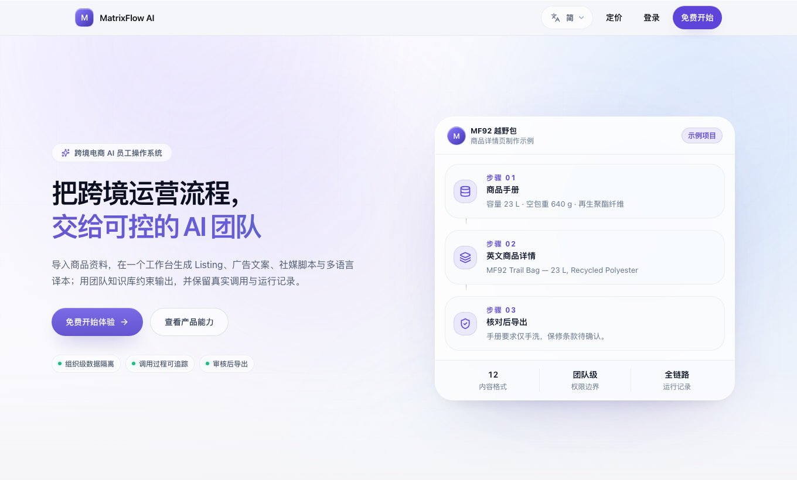

# MatrixFlow AI

为跨境电商团队制作可核对来源的多语言商品内容。把商品手册关联到内容项目，生成详情页、FAQ 或广告草稿，逐项核对规格后导出。

[在线体验](https://matrixflow-ai-sycamore-tree.vercel.app) · [制作第一份商品详情页](docs/content-review-flow.md) · [本地开发](#本地开发) · [完整文档](docs/README.md)



[](https://github.com/Hephaestus-DevKit/matrixflow-ai/actions/workflows/ci.yml)
[](https://github.com/Hephaestus-DevKit/matrixflow-ai/actions/workflows/codeql.yml)
[](https://github.com/Hephaestus-DevKit/matrixflow-ai/actions/workflows/appwrite.yml)
[](https://github.com/Hephaestus-DevKit/matrixflow-ai/actions/workflows/production-smoke.yml)

在线体验由 Vercel 提供前端，Appwrite 处理登录、团队数据和 AI 请求。使用在线工作台生成内容会消耗运营方的 DeepSeek API 配额。自行部署时，请配置自己的 Appwrite 项目和 DeepSeek 密钥，详见[部署手册](docs/deployment.md)。

## 可以做什么

| 场景     | 当前能力                                                                               |
| -------- | -------------------------------------------------------------------------------------- |
| AI 员工  | 创建、编辑、暂停和启用员工；挂接团队知识库，查看带来源的回答和历史输出。               |
| 内容制作 | 按语言、市场和文风生成商品文案等 12 类内容，支持单项或批量生成、复制和下载。           |
| 知识库   | 上传 PDF、DOCX、TXT、Markdown 或 CSV，建立索引、提问并追溯引用片段。                   |
| 工作流   | 可视化编排、条件分支、JSON 输入、版本记录与运行日志。                                  |
| 任务中心 | 后台执行生成、索引和工作流；查看进度、取消任务、读取或导出结果。                       |
| 团队协作 | 邮箱登录与验证、可选双重验证、团队角色、用量与审计；支持简体中文、繁體中文和 English。 |

## 制作第一份商品详情页

1. 注册并验证邮箱。在「内容工厂」点击「填入示例商品」，或填写自己的商品名称和已确认的规格。
2. 需要引用手册时，在「知识库」上传文档，等状态变为「已就绪」，再在创建内容项目时选择该库。
3. 选择目标语言和市场，在「商品详情页」点击「生成」。例如手册只确认容量为 23 L、空包重 640 g，审核时就应核对这两项，并将保修条款保留为待确认。
4. 展开检索来源，对照原文编辑草稿，勾选审核后复制或下载。**编辑稿只在当前页面保留，请在离开前下载。** 下载文件包含审核后的文字及关联的来源摘录。

当前为 **Beta**。核心工作台已上线；模板市场、付费结账和外部消息发送仍是预览或需要额外配置。知识库使用关键词与片段检索，适合中小型资料集。[产品成熟度与边界](docs/product-readiness.md)

## 架构与目录

生产前端运行在 **Vercel（Next.js 15）**，Appwrite Cloud Singapore 提供认证、团队、TablesDB、文件存储和 Node.js 22 函数。业务写入统一通过 `matrixflow-core` 校验团队、角色、输入和额度；浏览器只读取权限允许的数据。生产模型为 **DeepSeek Flash**，通过兼容 Anthropic Messages 的接口在函数内调用。

| 路径                                                             | 用途                                       |
| ---------------------------------------------------------------- | ------------------------------------------ |
| [apps/web](apps/web)                                             | Next.js 界面、语言和数据访问               |
| [apps/functions/matrixflow-core](apps/functions/matrixflow-core) | Appwrite 函数、AI 适配、后台任务和后端测试 |
| [packages/shared](packages/shared)                               | TypeScript 类型与 Zod 4 校验               |
| [infra/appwrite](infra/appwrite)                                 | 数据库、存储桶和函数声明                   |
| [e2e](e2e) · [scripts](scripts)                                  | 浏览器回归、配置审计和 smoke               |
| [docs](docs)                                                     | 架构、API、部署与生产运维                  |

## 本地开发

使用 Node.js 22.14+ 和 pnpm 11。从仓库根目录运行：

```bash
pnpm install --frozen-lockfile
npm ci --prefix apps/functions/matrixflow-core
pnpm dev
```

访问 <http://localhost:3000>。只看公开页面无需配置密钥。Web 的默认 Appwrite 配置指向生产项目；开发登录、写入或 AI 调用时，请先把 [配置样例](.env.example) 中的 `NEXT_PUBLIC_APPWRITE_ENDPOINT` 和 `NEXT_PUBLIC_APPWRITE_PROJECT_ID` 填入 `apps/web/.env.local`，并改为隔离的开发项目。模型密钥只存于 Appwrite Function Secret。

```bash
pnpm verify
# 本地默认使用 WebKit，CI 同时验证 WebKit 和 Chromium。
pnpm exec playwright install webkit
pnpm test:e2e
```

[贡献指南](CONTRIBUTING.md) 列出其他检查和 PR 要求。

## 发布与验收

- **前端：** Vercel 从 `main` 发布。定时或手动运行的 [Production smoke](https://github.com/Hephaestus-DevKit/matrixflow-ai/actions/workflows/production-smoke.yml) 检查六个公开页面、三语首屏与安全响应头。
- **后端：** `main` 的函数或 Appwrite 配置变更触发 [Appwrite deploy](https://github.com/Hephaestus-DevKit/matrixflow-ai/actions/workflows/appwrite.yml)。工作流同步资源、激活函数，并用专用账号验证登录、团队权限及真实模型调用。
- **运维：** 发布账号、Secrets、回滚及模型配置见[部署手册](docs/deployment.md)；监控与恢复目标见[生产运行基线](docs/operations.md)。

安全问题请按 [SECURITY.md](SECURITY.md) 私下报告。源代码公开可见，使用、修改或部署须遵守 [LICENSE](LICENSE)。
